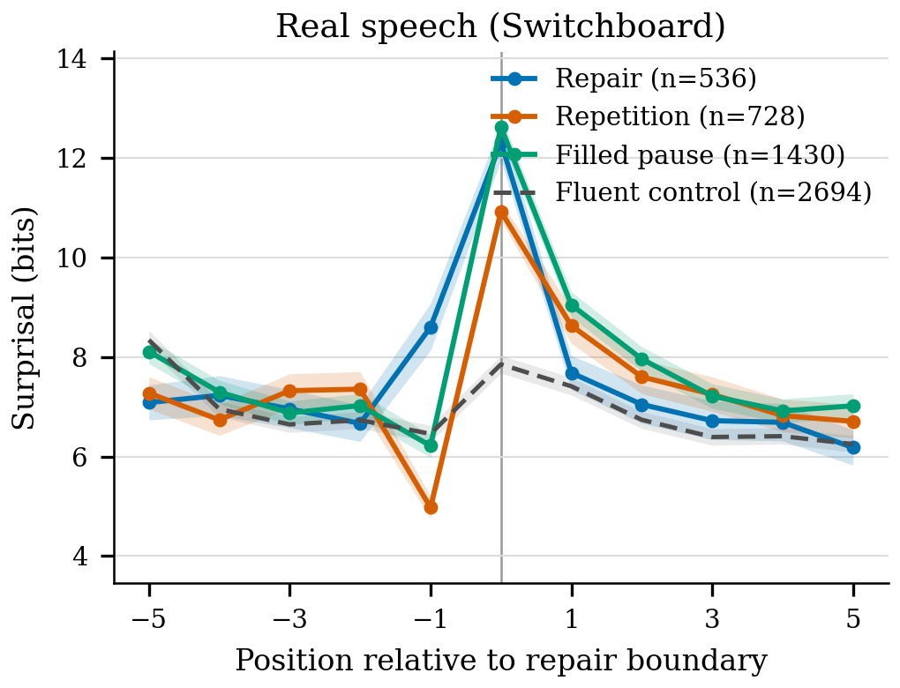

# Mend

Mend turns spoken dictation into written text. It removes filled pauses, resolves
self-repairs, and restores casing and punctuation:

```
send it to john no wait sarah um by friday
-> Send it to Sarah by Friday.
```

There is no corpus of paired dictation and its cleaned-up form, so Mend builds one:
a disfluency injector runs clean written sentences backwards into plausible speech,
keeping a record of exactly what it inserted and where. Those spans are what make
the rest possible — they give the evaluation something to score against, and they
give the surprisal analysis a boundary to centre on.

The repo contains:

* `mend/injector.py` — the disfluency injector, structured the way Shriberg
  describes self-repair: **reparandum** (the abandoned material), **interregnum**
  (the editing phrase), **repair** (what replaces it).
* `mend/swda.py` — a parser for real conversational speech, which emits the same
  schema, so nothing downstream needs to know whether a pair is synthetic or real.
* two fine-tuned models — flan-t5-small, seq2seq, `clean up: {disfluent}` →
  `{clean}` — one trained on synthetic pairs alone and one with real speech mixed
  in, so the difference between them is measurable rather than asserted.
* one evaluation table — `outputs/eval_table.md`.
* the surprisal-at-repair-boundary figures, on synthetic and on real speech.

The short version of the results: synthetic disfluencies alone get you a third of
real self-repairs, and mixing in real speech gets you half. Both numbers are in
the table, measured on conversations neither model was trained on.

## Setup

```bash
uv venv --python 3.12 .venv
uv pip install -e ".[dev]"
```

Any environment with the pinned dependencies in `pyproject.toml` works. The scripts
pick their device automatically: CUDA if present, otherwise Apple MPS, otherwise CPU.

## Using it

Once there is a model at `outputs/model`:

```console
$ mend-clean "um send the the report to john no wait sarah by friday"
Send the report to Sarah by Friday.

$ echo "so i was like really tired you know" | mend-clean
So I was really tired.
```

It reads stdin when given no arguments, one line in, one line out, so it works in
a pipe. Input is normalised to the register the model was trained on — lowercased,
edge punctuation removed — so pasting text that already has capitals and commas
works; `--raw` skips that. `--show-input` prints both sides.

`outputs/model` points at the model trained with real speech mixed in, which is
the better of the two on every set. Read the accuracy section before trusting it
on anything: it removes filled pauses and restores punctuation reliably, and
resolves about half of real self-repairs.

## Running the stages

```bash
# 1. tests
pytest

# 2. synthetic training data: 50k/2k/10k pairs into data/
python -m mend.generate_data --smoke                       # 100 pairs, prints a sample
python -m mend.generate_data --train 50000 --val 2000 --test 10000 --seed 13

# 3. real speech (14 MB, no licence gate). Writes the whole parse for the
#    surprisal analysis, plus a conversation-disjoint train/val/eval beside it
curl -L -o swda.zip https://github.com/cgpotts/swda/raw/master/swda.zip
unzip -q swda.zip -d swda
python -m mend.swda --root swda --out data/swda_all.jsonl --split

# 4. fine-tune; writes <out>/checkpoints and links <out>/model at the best one
python -m mend.train --smoke --smoke-steps 150 --batch 32 --real 25000
#   the two systems in the table: synthetic only, then with real speech mixed in
python -m mend.train --batch 32 --epochs 2 --eval-steps 400 \
    --real 0 --out outputs/synthetic_only
python -m mend.train --batch 32 --epochs 2 --eval-steps 400 \
    --real 25000 --out outputs/mixed
#   --real -1 uses every real pair instead of a 25k sample
#   --resume auto picks up from the latest checkpoint if a run is interrupted
ln -sfn mixed/checkpoints/checkpoint-4000 outputs/model   # what mend-clean uses

# 5. the evaluation table; --model takes "label=path" and repeats
python -m mend.evaluate \
    --model "Mend (synthetic only)=outputs/synthetic_only/model" \
    --model "Mend (+ real speech)=outputs/mixed/model"

# 6. the surprisal figures
python -m mend.surprisal --data data/test.jsonl --draws 4000 \
    --title "Synthetic test split"
python -m mend.surprisal --data data/swda_all.jsonl --shuffle --limit 20000 \
    --draws 4000 --tag _swda --title "Real speech (Switchboard)"

# 7. run the model over your own text
mend-clean "um send the the report to john no wait sarah by friday"
```

Every stage is seeded and re-runnable. Do not run the surprisal pass next to
training on a 16 GB machine; together they exhaust memory and both crawl.

## Real speech

Everything synthetic in this repo measures one thing: how well the model inverts
this particular injector. To measure anything else you need speech nobody here
designed.

The [Switchboard Dialog Act corpus](https://github.com/cgpotts/swda) is freely
redistributable, is real telephone conversation, and its transcripts carry the
Treebank-3 disfluency annotation — which is the same structure the injector
imitates:

```
[ do you, + do you ] have any experience     repair: reparandum then repair
{F uh, }                                     filled pause
{E I mean, }                                 explicit editing term
{D you know, }                               discourse marker
```

`mend/swda.py` parses that into the same `InjectionResult` schema the injector
produces, so `evaluate.py` and `surprisal.py` read it with no changes. It yields
**81,107 utterances carrying 13,038 repairs, 15,622 repetitions and 35,412 filled
pauses**. Only complete slash units with balanced markup are kept, and utterances
containing a cut-off word ("d-") are dropped since nothing in training resembles
them.

### The split, and what it costs

Real speech now feeds training as well as evaluation, because the first round
showed that synthetic repairs alone do not teach the model to resolve real ones.
So the corpus is divided **by conversation**, never by utterance:

| Split | Conversations | Utterances | Repairs |
|---|---|---|---|
| train | 804 | 56,684 | 9,199 |
| val | 58 | 4,109 | 583 |
| eval | 293 | 20,314 | 3,256 |

Splitting by utterance would leak. The two speakers in a Switchboard call talk
about one assigned topic for ten minutes, so utterances from the same call share
vocabulary, subject matter and speaker habits; a model trained on half a call and
tested on the other half is being asked an easier question than the one we mean
to ask. Whole conversations therefore go to exactly one split.

This does spend something. In the first round nothing in the repo had ever been
fitted to SwDA, which made every number on it a clean zero-shot transfer result.
That is no longer true of the corpus as a whole — but the 293 evaluation
conversations have still never been trained on, and the synthetic-only model is
kept and re-scored on that same held-out set, so the before/after comparison
below is like for like. The zero-shot transfer finding is preserved as its own
row rather than overwritten.

The surprisal analysis reads the *whole* parse, not the held-out split: it
measures a property of human speech using a separate language model, so which
conversations Mend trained on has no bearing on it.

## Results

Two systems, identical except for what they were trained on:

* **Mend (synthetic only)** — 50k injected pairs, 2 epochs, about 66 minutes on an
  M-series Mac across an interrupted-and-resumed run. Validation loss 0.186 →
  0.146; best checkpoint step 2400.
* **Mend (+ real speech)** — the same 50k plus 25k real Switchboard utterances
  (33% of the mix), 2 epochs, 62 minutes. Validation loss 0.216 → 0.159; best
  checkpoint step 4000. The two validation figures are not comparable to each
  other: the second validation set contains real speech and is harder.

The copy baseline returns its input with a trivial rule applied — capitalise the
first word, uppercase standalone *i*, add a full stop — which isolates how much of
each score is punctuation restoration alone.

| System | Set | N | Exact match | WER | WER (words only) | Filler removal F1 | Repair resolution | Repairs scored |
|---|---|---|---|---|---|---|---|---|
| Copy baseline | held-out synthetic | 10000 | 0.030 [0.027, 0.033] | 0.310 | 0.132 | 0.000 | 0.000 [0.000, 0.000] | 2267 |
| Mend (synthetic only) | held-out synthetic | 10000 | 0.649 [0.639, 0.658] | 0.058 | 0.012 | 0.995 | 0.848 [0.832, 0.861] | 2267 |
| Mend (+ real speech) | held-out synthetic | 10000 | 0.646 [0.637, 0.655] | 0.058 | 0.012 | 0.996 | 0.863 [0.848, 0.877] | 2267 |
| Copy baseline | hard set | 100 | 0.080 [0.030, 0.140] | 0.684 | 0.597 | 0.000 | 0.000 [0.000, 0.000] | 88 |
| Mend (synthetic only) | hard set | 100 | 0.550 [0.450, 0.650] | 0.204 | 0.168 | 0.667 | 0.568 [0.460, 0.670] | 88 |
| Mend (+ real speech) | hard set | 100 | 0.610 [0.520, 0.710] | 0.177 | 0.143 | 0.571 | 0.648 [0.548, 0.747] | 88 |
| Copy baseline | real speech (SwDA) | 4000 | 0.325 [0.310, 0.339] | 0.222 | 0.117 | 0.000 | 0.000 [0.000, 0.000] | 519 |
| Mend (synthetic only) | real speech (SwDA) | 4000 | 0.455 [0.439, 0.470] | 0.125 | 0.056 | 0.859 | 0.326 [0.285, 0.366] | 519 |
| Mend (+ real speech) | real speech (SwDA) | 4000 | **0.616** [0.600, 0.631] | 0.073 | **0.026** | **0.955** | **0.503** [0.460, 0.546] | 519 |

The real-speech rows are the 293 held-out conversations, which neither model was
trained on. Bracketed ranges are 95% percentile bootstrap intervals over 2000
resamples, resampling **sentences** — a sentence is what was independently drawn
from the corpus, and the several disfluencies inside one are not independent of
each other, so resampling repairs instead would give intervals that are too
narrow.

Only the real-speech row is bolded, because it is the only one where the two
models are actually separated. **On real speech the intervals do not come close
to overlapping** (0.326 [0.285, 0.366] against 0.503 [0.460, 0.546]). Everywhere
else they overlap: the synthetic rows say the mixed model did not regress, not
that it improved, and the hard set at 100 sentences cannot separate 0.550 from
0.610 — that row is a direction, not a measurement.

> **The earlier version of this table reported 0.227 for repair resolution on real
> speech, not 0.326.** That was the same checkpoint measured on a different sample:
> 2000 utterances drawn from the whole corpus, carrying 242 scored repairs, before
> any split existed. Re-running the synthetic-only model under that old sampling
> now gives 0.260 on 265 repairs — the spread between 0.227 and 0.260 is what a
> couple of hundred scored repairs buys you. The held-out sample sits a little
> higher still at 0.326, which is what you would expect if conversations vary in
> difficulty, though at these sample sizes the intervals overlap and the gap is
> not firmly established. Nothing about the model changed; the measurement did.
> Both systems above are scored on the identical sample, so
> **0.326 → 0.503 is the like-for-like comparison**, and the evaluation sample was
> doubled to 4000 utterances so the headline number rests on 519 repairs.

Exact match normalises whitespace and treats the sentence-final mark as optional,
but is otherwise case-sensitive. WER is over whitespace tokens with punctuation
attached, so a missing comma costs one substitution; **WER (words only)** drops
casing and punctuation, which matters for the real-speech row because Switchboard
transcribers comma far more heavily than written prose, and a model trained on
WikiText is marked down there for house style rather than for anything to do with
disfluency. Filler removal F1 counts *occurrences* deleted rather than positions,
because a word like *like* can be a filled pause and a real word in the same
sentence; the scored vocabulary is the injector's filler words plus whatever each
transcript itself annotates as a filler. Repair resolution asks whether the
reparandum is gone and the repair is present, using annotated spans where they
exist and the input/gold word-multiset difference otherwise.

### Surprisal at repair boundaries

Per-token surprisal from pythia-160m, summed within each whitespace word, centred
on the boundary token — the first token of the editing phrase, or of the repair
where there is none. The control is the *same* utterance with its disfluencies
removed, read at the matching word position, so each instance is its own baseline.

| Synthetic | Real speech |
|---|---|
|  |  |

Surprisal spikes at the interruption in both, for all three types, with every
interval excluding zero (95% bootstrap CIs over 4000 resamples of the paired
per-instance differences):

| Type | Synthetic | Real speech (SwDA) |
|---|---|---|
| Repair | +3.84 bits [+2.86, +4.84] at −1 (n=311) | **+4.82 bits [+4.42, +5.21] at 0** (n=548) |
| Repetition | +2.91 bits [+2.23, +3.58] at 0 (n=447) | +5.75 bits [+5.45, +6.05] at 0 (n=653) |
| Filled pause | +5.22 bits [+4.80, +5.65] at +1 (n=1652) | +3.09 bits [+2.76, +3.43] at 0 (n=1430) |

The real-speech result is the one worth quoting: 548 genuine human self-repairs,
the peak landing exactly on the interruption point, an effect of about five bits.

This analysis reads the whole corpus, both the conversations Mend trained on and
the ones it did not, because it measures human speech with a separate language
model and Mend plays no part in it. An earlier run over a different 20,000-utterance
sample of the same corpus gave +4.57 [+4.17, +4.98] on 536 repairs, +5.66 on
repetitions and +3.42 on filled pauses — the same three peaks in the same places,
which is the reassuring part.

The two panels differ in a way that indicts the generator. On real speech all three
peaks sit exactly at position 0. On synthetic data the repair peak sits one position
*earlier*, on the reparandum. That is because the injector's reparandum is a word
drawn at random from a category — "send it to *Omar*" when the sentence is about
Sarah — and a random substitution is inherently surprising. A real speaker's
abandoned word is something they were plausibly about to say, so the surprise waits
for the interruption itself. The synthetic figure is measuring the generator's
randomness as much as the phenomenon.

Two further caveats. The reported effects are paired against each type's own
control, while the dashed line pools all control windows, so a gap read straight off
a plot will not reproduce the table. And only disfluencies with a complete ±5 window
on both sides are analysed.

## Honest summary

**Synthetic repairs do not teach a model to resolve real ones. Real repairs do,
and the synthetic data was not what was holding it back.**

The synthetic-only model resolves 84.8% of injected repairs and 32.6% of real
ones — a model that has only ever seen the injector's output handles about a
third of what a human actually does when they correct themselves. Injected
repairs are category substitutions with a stock editing phrase; real self-repairs
are none of those things. Anyone reading the 0.848 as evidence of a dictation
cleanup system would be wrong by roughly a factor of three.

Adding 25k real utterances to the training mix takes real-speech repair
resolution to **0.503 [0.460, 0.546]**, cuts words-only WER from 0.056 to
**0.026**, and lifts filler removal from 0.859 to **0.955**. That is the one
result here with a comfortable margin — the two intervals are far apart.

What it does *not* do is improve anything else measurably. On the synthetic split
the intervals overlap in both directions (exact match 0.649 → 0.646, repair
resolution 0.848 → 0.863), which supports "did not regress" and nothing stronger.
The hard set moves 0.550 → 0.610, but at 100 sentences that interval is ±0.10 and
the two models are not separated. The useful reading is that the worry — that
telephone conversation would drag the model off the dictation register — did not
materialise at a third of the mix, rather than that mixing helped everywhere.

Half of real self-repairs still go unresolved. That remains the honest ceiling.

### How much of the real-speech gain is really disfluency?

Some of it is house style. The mixed model has learned Switchboard's comma
conventions along with its disfluencies — *so uh what was the last car repair you
had* comes back as *So, what was...* rather than *So what was...*, which is worth
a chunk of the plain-WER improvement and nothing at all in cleanup quality. Three
things argue the gain is not only that:

* **words-only WER**, which is blind to punctuation and casing, still more than
  halves (0.056 → 0.026);
* **repair resolution** is a word-multiset test that ignores punctuation entirely;
* the failures that disappear are real ones. *are you going to go to east texas
  for that* came back from the synthetic-only model as *Go to Texas for that.* —
  a catastrophic over-deletion — and from the mixed model correctly.

The caveat that remains: the model is now trained on SwDA's annotation
conventions and evaluated against them. That is legitimate for measuring whether
it learned real disfluency structure, and it would flatter the model against any
corpus that draws the removable/keepable line somewhere else.

### The characteristic failures, after mixing

* **Over-deletion of literal fillers is largely fixed but traded.** Filler removal
  on real speech rose to 0.955, but hard-set *filler-as-content* fell 8/14 → 7/14.
  The model is better calibrated on conversational fillers and slightly worse on
  the adversarial dictation cases.
* **Fragments are still unhandled.** *it sure does ma make a difference* keeps the
  cut-off *ma*, because utterances containing cut-off words are dropped from the
  SwDA parse — nothing in training resembles them.
* **Discourse-marker disagreement is now mostly resolved** in Switchboard's
  favour, which is a convention the model has been taught rather than a judgement
  it makes.

### Hard set by phenomenon

Exact match on each of the eight adversarial categories, both models:

| Phenomenon | synthetic only | + real speech |
|---|---|---|
| Overlapping repair | 11/14 | **12/14** |
| Cross-clause repair | 4/12 | **5/12** |
| False start | 2/8 | 2/8 |
| Filler used literally | 8/14 | 7/14 |
| Repetition | 7/8 | 7/8 |
| Number and date repair | 12/16 | **14/16** |
| Multi-repair | 9/16 | **10/16** |
| Nested repair | 2/12 | **4/12** |
| **total** | **55/100** | **61/100** |

Six of eight categories improve or hold, and the one that regresses is
filler-as-content — the model traded a little of its dictation-register
calibration for a lot of conversational-filler accuracy. **With 8–16 examples per
phenomenon these per-row differences are not statistically meaningful** — read
them as directions, not measurements. Nested repair at 4/12 remains the worst
category by some distance, and neither training mix has touched false starts.

An earlier round widened the injector itself — three-token repairs that overlap
their reparandum, corrections that arrive a clause late, mid-sentence false
starts, literal filler words in a third of targets. That moved hard-set exact
match 0.530 → 0.550, trading multi-repair and nested repair for overlapping and
cross-clause. Widening the generator rearranged the failures; real data was what
actually moved the total.

### On the status of the hard set

The hard set was built to probe failure modes, and then the training distribution
was changed in response to what it found. That makes it a **development set**, not
a held-out measurement, for the filler-as-content and repair-shape categories. Its
numbers are optimistic to an unknown degree.

The 293 held-out SwDA conversations are the honest benchmark. They were never
trained on, and the split was drawn before either model in the table existed. The
corpus as a whole no longer has the stronger property it had in the previous
round — that nothing in the repo had ever been fitted to any part of it.

### Limitations

Real disfluent speech now reaches the model, but only Switchboard telephone
conversation, and only through a transcriber's annotation conventions; the model
has been taught where *that* corpus draws the removable line. There is still no
real ASR output anywhere in the pipeline — the disfluent side is always a
transcript, never a recognition hypothesis, so it carries none of the substitution
errors a real recogniser makes. The injector's repairs are still drawn from closed
word categories. Utterances containing cut-off words are dropped from the SwDA
parse, so fragments are unhandled by construction. And the surprisal analysis,
though it rests on 548 real repairs, uses a 160M-parameter LM whose absolute bit
values would shift with a larger one — the direction and the position of the peak
are the robust parts, not the magnitude.

## A note on `data/hard_set.jsonl`

The hard set is 100 adversarial examples covering nested repairs, repairs that
cross a clause boundary, repairs whose reparandum and repair share words, words
like *like* and *sorry* used literally rather than as fillers, number and date
repairs, and sentences carrying several repairs at once.

It has since been reviewed. Every gold was checked to be reachable from its input
by deletion plus casing and punctuation — no example asks the model to invent a
word the speaker never said — and there are no duplicate inputs or golds. One
inconsistency was found and fixed: *the flight leaves at 6 45 no wait 7 45* asked
for `7:45`, while every other number row copies its digits verbatim (`555 0128`
keeps its space, *at 3 no at 4* stays a bare `4`). The set's convention is that
repairs get resolved, not that numbers get reformatted, so the gold is now `7 45`.

Two things to know before quoting a hard-set number. Exact match on four rows
turns on orthography rather than disfluency — *like-minded*, *north-east*,
*double-sided*, and the apostrophe in *Let's* — which is legitimate written
English but is not what the set was built to probe. And it remains a development
set for the categories the injector was tuned against.

## Layout

```
mend/injector.py       disfluency injection with reparandum/interregnum/repair spans
mend/generate_data.py  WikiText + dictation templates -> (disfluent, clean) pairs
mend/swda.py           Switchboard transcripts -> the same schema, from real speech,
                       and the conversation-disjoint split
mend/train.py          seq2seq fine-tune, synthetic pairs with real speech mixed in
mend/evaluate.py       the results table, one row per system per set
mend/surprisal.py      per-token surprisal and the figures
mend/clean.py          the mend-clean command, for running the model over text
data/hard_set.jsonl    100 hand-written hard cases
outputs/synthetic_only/model  trained on injected pairs alone
outputs/mixed/model           trained with 25k real utterances mixed in
outputs/model          symlink to whichever of the two mend-clean should use
outputs/               table, figures, predictions, checkpoints
DECISIONS.md           one line per engineering decision made along the way
```
