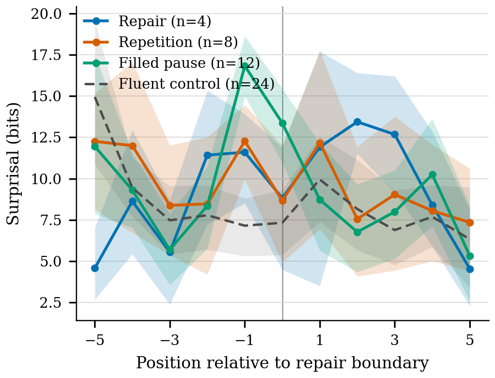

# Mend

Mend turns spoken dictation into written text. It removes filled pauses, resolves
self-repairs, and restores casing and punctuation:

```
send it to john no wait sarah um by friday
-> Send it to Sarah by Friday.
```

There is no corpus of paired dictation and its cleaned-up form, so Mend builds one:
a disfluency injector runs clean written sentences backwards into plausible speech,
keeping a record of exactly what it inserted and where. Those spans are what make
the rest possible — they give the evaluation something to score against, and they
give the surprisal analysis a boundary to centre on.

The repo contains four things:

* `mend/injector.py` — the disfluency injector, structured the way Shriberg
  describes self-repair: **reparandum** (the abandoned material), **interregnum**
  (the editing phrase), **repair** (what replaces it).
* one fine-tuned model — flan-t5-small, seq2seq, `clean up: {disfluent}` → `{clean}`.
* one evaluation table — `outputs/eval_table.md`.
* one figure — surprisal around repair boundaries, `outputs/surprisal_at_repair.pdf`.

## Setup

```bash
uv venv --python 3.12 .venv
uv pip install -e ".[dev]"
```

Any environment with the pinned dependencies in `pyproject.toml` works. The scripts
pick their device automatically: CUDA if present, otherwise Apple MPS, otherwise CPU.

## Running the stages

```bash
# 1. tests for the injector
pytest

# 2. training data: 50k/2k/2k pairs into data/
python -m mend.generate_data --smoke                       # 100 pairs, prints a sample
python -m mend.generate_data --train 50000 --val 2000 --test 2000 --seed 13

# 3. fine-tune; writes outputs/checkpoints and links outputs/model at the best one
python -m mend.train --smoke --smoke-steps 150 --batch 32  # checks the loss falls
python -m mend.train --batch 32 --epochs 2 --eval-steps 400

# 4. the evaluation table
python -m mend.evaluate

# 5. the surprisal figure
python -m mend.surprisal --device cpu
```

Every stage is seeded and re-runnable. Stage 5 is deliberately pinned to the CPU:
running it next to training exhausts memory on a 16 GB machine and both crawl.

## Results

Trained on 50k pairs for 2 epochs on an M-series Mac (54 minutes). Validation loss
fell at every evaluation, 0.178 → 0.131, so early stopping never fired.

The copy baseline returns its input with a trivial rule applied — capitalise the
first word, uppercase standalone *i*, add a full stop — which isolates how much of
the score is punctuation restoration alone.

| System | Set | N | Exact match | WER | Filler removal F1 | Repair resolution | Repairs scored |
|---|---|---|---|---|---|---|---|
| Copy baseline | held-out synthetic | 2000 | 0.032 | 0.318 | 0.000 | 0.000 | 472 |
| Mend (flan-t5-small) | held-out synthetic | 2000 | 0.644 | 0.057 | 0.999 | 0.945 | 472 |
| Copy baseline | hard set | 100 | 0.080 | 0.689 | 0.000 | 0.000 | 88 |
| Mend (flan-t5-small) | hard set | 100 | 0.530 | 0.236 | 0.667 | 0.534 | 88 |

Exact match ignores whitespace differences and treats the sentence-final mark as
optional, but is otherwise case-sensitive. WER is over whitespace tokens with
punctuation still attached, so a missing comma costs one substitution. Filler
removal F1 counts *occurrences* of filler words deleted rather than positions,
because a word like *like* can be a filled pause and a real word in the same
sentence. Repair resolution asks whether the reparandum is gone and the repair is
present; on the synthetic split it uses the injector's spans, and on the hard set,
which has none, it uses the word-multiset difference between input and gold.

### Surprisal at repair boundaries



Per-token surprisal from pythia-160m over the disfluent test sentences, summed
within each whitespace word, centred on the boundary token — the first token of the
editing phrase, or of the repair where there is none. The control is the *same*
sentence with its disfluencies removed, read at the matching word position, so each
instance is its own baseline.

Surprisal spikes at the interruption, for all three types:

| Type | n | Peak effect | Position | At the boundary |
|---|---|---|---|---|
| Repair | 64 | **+7.34 bits** [+5.56, +9.07] | −1 | +3.87 bits [+2.67, +5.06] |
| Repetition | 74 | **+4.87 bits** [+3.81, +5.94] | 0 | +4.87 bits [+3.81, +5.94] |
| Filled pause | 298 | **+5.10 bits** [+4.23, +5.95] | 0 | +5.10 bits [+4.23, +5.95] |

95% bootstrap CIs over 4000 resamples of the paired per-instance differences. Every
interval excludes zero.

For repairs the peak sits one position *before* the editing phrase — on the
reparandum, the wrong word itself. That is where the model's expectation breaks
first; "no wait" then arrives as partial confirmation and is less surprising than
the error that prompted it. Two caveats. The reported effects are paired against
each type's own control, while the dashed line in the figure pools all 436 control
windows, so a gap read straight off the plot will not reproduce the table. And only
disfluencies with a complete ±5 window on both sides are analysed, which keeps 64 of
472 repairs — the repair line is the thinnest in the figure and its band the widest.

## Honest summary

The model does the job it was trained on and does it well: on held-out synthetic
data it removes filled pauses almost perfectly (F1 0.999), resolves 94.5% of
injected repairs, and cuts WER from 0.318 to 0.057. Exact match is 0.644, and most
of the remaining gap is commas the model places defensibly but differently from the
source.

The hard set is where the ceiling shows, and the breakdown by phenomenon says
plainly what was learned:

| Phenomenon | Exact match |
|---|---|
| Repetition | 7/8 |
| Number and date repair | 13/16 |
| Multi-repair | 12/16 |
| Overlapping repair | 8/14 |
| Filler used literally | 7/14 |
| Nested repair | 4/12 |
| False start | 1/8 |
| Cross-clause repair | 1/12 |

What the model actually learned is close to "delete the token just before the
editing phrase". That handles the injector's repairs, which are single-token,
same-category, and immediately followed by their correction. It does not generalise:

* Cross-clause repairs (1/12) need material moved across a clause boundary, which
  the injector never produces.
* Overlapping repairs fail in a specific way — given *the report the quarterly
  report is late* it returns *The report is late*, keeping the abandoned version
  and dropping the correction.
* Fillers used literally are over-deleted: *there are like minded groups* loses its
  *like*, and *you know the answer better than i do* loses its *you know*. This is
  the direct cost of an injector that inserts *like* and *you know* as pure noise —
  the model never saw a case where keeping them was right.

So the fair reading is that the synthetic numbers measure how well the model
inverted this particular injector, not how well it cleans up real dictation. The
gap between 0.945 and 0.534 repair resolution is the size of that distinction. The
surprisal result is the more robust finding, since it involves no trained model at
all — only an off-the-shelf LM and the injector's annotations.

Other limitations worth stating: everything is synthetic, with no real ASR output
or real disfluent speech anywhere in the pipeline; the injector's repairs are all
single-token swaps within closed categories; WikiText prose and template imperatives
are the only two registers; and the surprisal analysis rests on 64 repair instances.

## A note on `data/hard_set.jsonl`

The hard set is 100 adversarial examples covering nested repairs, repairs that
cross a clause boundary, repairs whose reparandum and repair share words, words
like *like* and *sorry* used literally rather than as fillers, number and date
repairs, and sentences carrying several repairs at once. It was drafted in one
pass and **has not been reviewed by a second pair of eyes**. Read it and edit it
by hand before quoting any hard-set number as a result — it is the source of every
number in the bottom half of the results table.

## Layout

```
mend/injector.py       disfluency injection with reparandum/interregnum/repair spans
mend/generate_data.py  WikiText + dictation templates -> (disfluent, clean) pairs
mend/train.py          seq2seq fine-tune
mend/evaluate.py       the results table
mend/surprisal.py      per-token surprisal and the figure
data/hard_set.jsonl    100 hand-written hard cases
outputs/               table, figure, predictions, checkpoints
DECISIONS.md           one line per engineering decision made along the way
```
